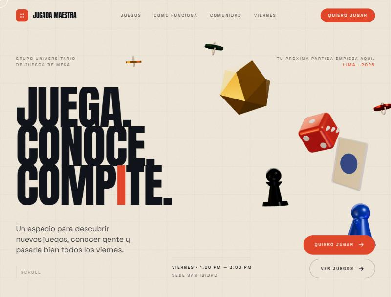
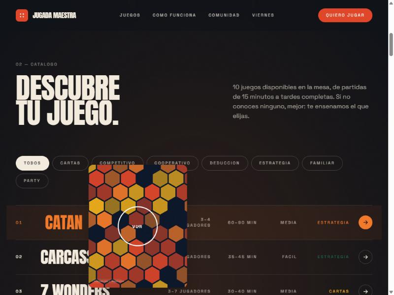
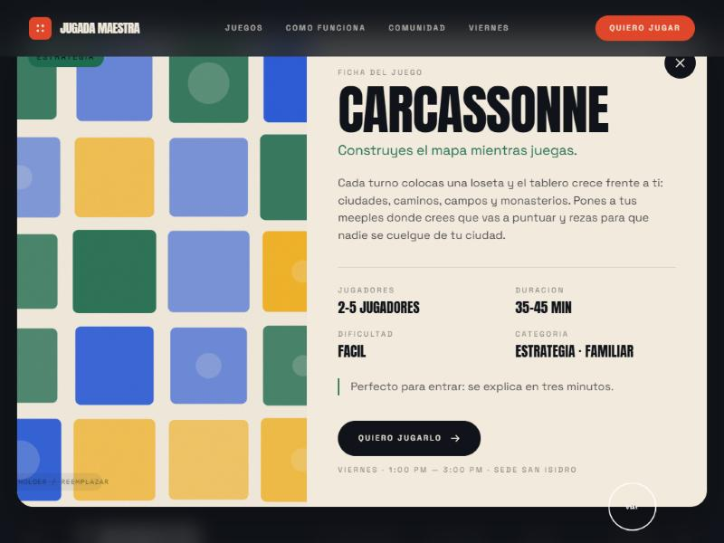
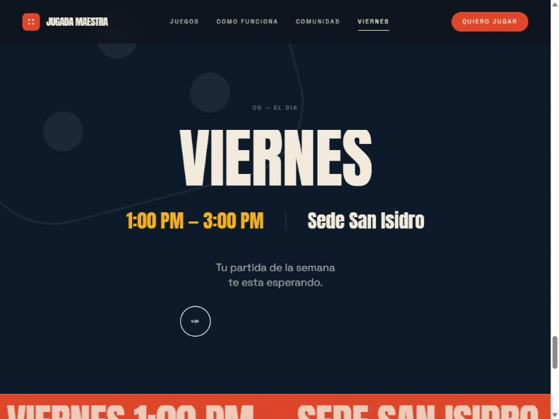

<div align="center">

# 🎲 JUGADA MAESTRA

### **JUEGA. CONOCE. COMPITE.**

**Tu próxima partida empieza aquí.**

Landing experiencial para un grupo universitario de juegos de mesa.
Tipografía enorme, piezas 3D flotando y scroll como parte del relato.

<br>

`VIERNES` · `1:00 PM — 3:00 PM` · `SEDE SAN ISIDRO`

<br>

[](https://react.dev)
[](https://www.typescriptlang.org)
[](https://vite.dev)
[](https://tailwindcss.com)
[](https://gsap.com)
[](https://threejs.org)

<br>

### [**→ VER EL SITIO EN VIVO ←**](https://inotchill.github.io/Jugada-Maestra/)

<br>



</div>

<br>

## 🎯 La idea

No es una página institucional de universidad. Es una **campaña digital** para un
grupo de juegos de mesa: el usuario entra, se queda mirando y piensa
*"esto se ve increíble, quiero ir a jugar"*.

Todo está construido alrededor de una sola frase:

> ### *Tu próxima partida empieza aquí.*

La información no se presenta: **se descubre mientras haces scroll.**

<br>

## 📸 Así se ve

<table>
<tr>
<td width="50%">

<p align="center"><strong>Catálogo interactivo</strong><br><sub>La lámina persigue al cursor y la sección se tiñe con el acento del juego</sub></p>
</td>
<td width="50%">

<p align="center"><strong>Ficha del juego</strong><br><sub>Jugadores, duración, dificultad, categoría y un consejo para novatos</sub></p>
</td>
</tr>
<tr>
<td colspan="2">

<p align="center"><strong>Los viernes</strong><br><sub>Pausa visual deliberada después de las animaciones: fondo profundo, mucho aire, una sola idea</sub></p>
</td>
</tr>
</table>

<br>

## ✨ Qué tiene dentro

| | |
| :-- | :-- |
| 🎲 **Hero en 3D** | D20, dados, carta, peón y fichas flotando, con parallax de cursor y deriva por scroll. Modelos reales optimizados a **316 KB en total** |
| 🃏 **Catálogo interactivo** | Índice editorial en desktop con lámina que sigue al cursor; carrusel con snap en móvil. Filtros por categoría derivados de los datos |
| 📖 **Relato con pin** | "Cómo funciona" fija la sección y cambia de escena en cada etapa mientras haces scroll |
| 🎨 **Sistema visual propio** | Crema y marfil de base, bermellón como acción, amarillo de acento. Dos familias tipográficas, ni una más |
| 🖱️ **Microinteracciones** | Cursor propio con etiquetas, botones magnéticos, barrido de relleno, revelados por líneas enmascaradas |
| 📱 **Móvil adaptado, no recortado** | La composición 3D se reagrupa, el catálogo cambia de formato y **nada depende de `hover`** |
| ⚡ **Rendimiento cuidado** | three.js va en chunk aparte y en diferido; el canvas deja de renderizar al salir de pantalla |
| ♿ **Accesible de verdad** | `prefers-reduced-motion` apaga scroll suave, 3D y parallax; el modal atrapa el foco y cierra con `Escape` |

<br>

## 🚀 Arrancar

```bash
git clone https://github.com/iNotChill/Jugada-Maestra.git
cd Jugada-Maestra
npm install
npm run dev
```

Abre **http://localhost:5173** y listo.

| Script | Qué hace |
| :-- | :-- |
| `npm run dev` | Servidor de desarrollo |
| `npm run build` | Chequeo de tipos + build de producción en `dist/` |
| `npm run preview` | Sirve el build de producción |
| `npm run art` | Regenera el arte placeholder de `public/images/` |
| `npm run lint` | oxlint |

<br>

## 🧩 Agregar un juego

El catálogo entero sale de un array. **No hay que tocar ningún componente:**

```ts
// src/data/games.ts
{
  id: 'wingspan',                              // = nombre del archivo de imagen
  name: 'Wingspan',
  tagline: 'Un motor de aves que se arma solo.',
  image: '/images/games/wingspan.webp',
  players:  { min: 1, max: 5 },
  duration: { min: 40, max: 70 },
  difficulty: 'Media',
  categories: ['Estrategia', 'Cartas'],
  description: 'Atraes aves a tu reserva y cada una potencia a las siguientes...',
  accent: 'pine',                              // ember · flare · gold · cobalt · pine
  tip: 'Las cartas se leen solas: ideal para una primera partida tranquila.',
}
```

Guarda y ya está: aparece en el índice, en el carrusel, en los filtros y con su
ficha completa. Los filtros por categoría se **derivan** de los datos, así que
una categoría nueva se da de alta sola.

El horario, la sede, los pasos y las fotos viven en
[`src/data/site.ts`](src/data/site.ts).

<br>

## 🛠️ Stack

| Herramienta | Para qué |
| :-- | :-- |
| **React 19 + TypeScript + Vite** | Base del proyecto |
| **Tailwind CSS v4** | Sistema visual en `@theme` (un solo sitio para colores y tipografía) |
| **GSAP + ScrollTrigger** | Revelados, parallax, pin y scrub |
| **Lenis** | Scroll suave, sincronizado con el ticker de GSAP |
| **React Three Fiber + drei** | Solo la composición del hero |
| **@fontsource** | Anton y Space Grotesk servidas desde el propio proyecto, sin CDN |

<br>

## 📂 Estructura

```
src/
├── components/
│   ├── Navbar.tsx          nav mínima que invierte color según la sección
│   ├── Hero.tsx            titular + composición 3D + datos del evento
│   ├── hero/
│   │   ├── HeroScene.tsx   canvas, luces, anclaje de piezas al viewport
│   │   └── pieces.tsx      carga y normaliza los modelos .glb
│   ├── GameExplorer.tsx    catálogo: índice en desktop, carrusel en móvil
│   ├── GameCard.tsx        fila o tarjeta, según el layout
│   ├── GameModal.tsx       ficha completa del juego
│   ├── HowItWorks.tsx      relato de 4 etapas con pin en desktop
│   ├── Community.tsx       collage con parallax + cifras
│   ├── FridaySection.tsx   pausa visual
│   ├── FinalCTA.tsx        cierre
│   ├── Footer.tsx
│   └── ui/                 MaskedLines · Reveal · ActionButton · Marquee
│                           CustomCursor · StepVisual
├── data/                   👈 games.ts · site.ts  (todo el contenido editable)
├── hooks/                  useMediaQuery · useSmoothScroll
├── lib/gsap.ts             registro de plugins
└── types/game.ts
```

<br>

## 🎨 Paleta

| Token | Hex | Uso |
| :-- | :-- | :-- |
| `cream` / `bone` / `paper` | `#F2EBDD` `#E4D9C4` `#FBF7EF` | Fondos claros |
| `ink` / `navy` | `#101319` `#0C1A2B` | Texto y secciones oscuras |
| `ember` / `flare` | `#E0472A` `#F0792B` | Color de acción |
| `gold` | `#F2B01E` | Acento |
| `cobalt` / `pine` | `#2B5BD7` `#1F6B4F` | Detalles puntuales |

Tipografía: **Anton** para titulares y **Space Grotesk** para texto.
El titular del hero se limita por ancho **y por alto** (`min(12vw, 18svh)`) para
que no aplaste al resto en pantallas bajas.

<br>

## 🎬 Animaciones

Cada una tiene un porqué. Ninguna está de adorno:

| Dónde | Qué hace |
| :-- | :-- |
| **Hero** | Revelado por líneas enmascaradas, piezas flotando, parallax de cursor, deriva por scroll |
| **Transiciones** | Cintas en marcha que cambian el fondo entre secciones |
| **Catálogo** | Lámina que sigue al cursor, tinte de sección por acento, reentrada escalonada al filtrar |
| **Cómo funciona** | Sección fijada con cambio de escena por etapa |
| **Comunidad** | Parallax a distintas velocidades por foto |
| **Viernes** | Pausa deliberada: solo un acercamiento lentísimo |
| **Botones** | Atracción magnética y barrido de relleno |

<br>

## ⚡ Rendimiento

- El chunk de three.js (~266 KB gzip) va **aparte y en diferido**: el titular
  pinta antes de que empiece a descargarse.
- El canvas **deja de renderizar** cuando el hero sale de pantalla
  (`IntersectionObserver` → `frameloop="never"`).
- Los modelos venían de escaneo, con hasta 438.000 triángulos para piezas que
  en pantalla ocupan 100 px: `npm run models` los simplifica y comprime con
  meshopt, de **28,5 MB a 316 KB** (99% menos). El decodificador de meshopt va
  dentro de three, así que no se descarga nada de un CDN.
- El mapa de entorno que da el reflejo metálico se genera en la propia escena:
  **no se descarga ningún HDR**.
- Las cintas infinitas son CSS puro, sin coste por frame.
- Imágenes con `loading="lazy"` y `decoding="async"`.

<br>

## 🚢 Despliegue

El sitio se publica solo: cada push a `main` dispara
[`.github/workflows/deploy.yml`](.github/workflows/deploy.yml), que compila y
sube **únicamente `dist/`** a GitHub Pages.

> [!IMPORTANT]
> En **Settings → Pages → Build and deployment**, la fuente tiene que ser
> **GitHub Actions**, no *Deploy from a branch*.
>
> Apuntar Pages a la rama tal cual sirve el `index.html` del código fuente —el
> que carga `/src/main.tsx`— y el navegador se queda **en blanco**, porque
> GitHub no compila proyectos de Vite.

Como Pages publica en un subdirectorio (`/Jugada-Maestra/`), el build lleva
`base` en [`vite.config.ts`](vite.config.ts) y todas las imágenes de `public/`
pasan por el helper [`asset()`](src/lib/asset.ts). Con un dominio propio, basta
con dejar `PROD_BASE` en `'/'`.

<br>

## 📝 Pendiente

- [ ] Cambiar `site.joinUrl` por el enlace real de inscripción (hoy apunta a `#sumarse`)
- [ ] Actualizar `site.instagram`
- [ ] **Jaipur**: falta su fotografía, así que el juego está fuera del catálogo.
      Deja `jaipur.webp` en `public/images/games/` y recupera su objeto en
      [`src/data/games.ts`](src/data/games.ts) (está en el historial de git)
- [ ] `og-image.jpg` (1200 × 630): la miniatura al compartir el enlace. Sin ella,
      pegar la URL en WhatsApp o Instagram no muestra imagen
- [ ] `apple-touch-icon.png` (180 × 180), para la pantalla de inicio en móvil

- [x] ~~Fotografías del catálogo y de comunidad~~ — 13 fotos en WebP

> Las fotos reales ya están en `public/images/`. Quedan ahí los SVG generados
> como respaldo; `npm run art` los regenera y
> [`public/images/README.md`](public/images/README.md) explica el formato que
> espera cada hueco.

<br>

---

<div align="center">

**VIERNES · 1:00 PM — 3:00 PM · SEDE SAN ISIDRO**

*No importa si vienes por primera vez o si ya tienes tu juego favorito.*

</div>
